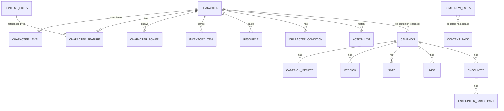

# Technical Architecture

Status: Phase 0 draft. Nothing here is implemented yet.

## 1. Verified toolchain (checked 2026-11-06)
Verified from the npm registry (`npm view expo dist-tags`) and `bundledNativeModules.json` of `expo@58.0.23`:

| Package | Version | Note |
|---|---|---|
| expo | 58.0.23 (`latest`) | SDK 58 |
| react-native | 0.88.1 | SDK-bundled |
| react | 19.3.0 | SDK-bundled |
| expo-router | ~58.0.30 | |
| expo-sqlite | ~58.0.15 | |
| expo-file-system / expo-sharing / expo-document-picker | ~58.0.13 / ~58.0.22 / ~58.0.4 | export/import |
| expo-crypto | ~58.0.7 | CSPRNG, UUIDs |
| expo-secure-store | ~58.0.2 | future auth tokens |
| expo-localization | ~58.0.5 | i18n locale detection |
| react-native-reanimated | 4.7.1 | animations |
| react-native-screens / safe-area-context | ~4.30.1 / ~5.11.1 | |

Rules: install only via `npx expo install`; run `npx expo-doctor` after dependency changes. Non-Expo libs (zustand, zod, react-hook-form, jest-expo, @testing-library/react-native) pinned at Phase 1 after checking peer ranges against React 19.3 / RN 0.88.
Unverified: exact Node version requirement for SDK 58 (dev machine runs Node v26.13 — verify in Phase 1; may need an LTS via nvm).
Unverified: Expo Router / SQLite API details for SDK 58 — read official SDK 58 docs before coding (ADR-0001).

## 2. Platform constraints
- Dev host: Linux x86_64. Android tools: `adb`, `java` present; **no Android SDK/emulator configured** (`ANDROID_HOME` unset); no `eas-cli`.
- **iOS cannot be built on Linux.** iOS verification requires EAS Build (cloud) + a physical device/TestFlight or a macOS machine. Requires Apple Developer account for device/TestFlight (decision needed). Until then iOS is verified by: shared-code constraints, `expo-doctor`, EAS iOS simulator builds, and avoiding Android-only APIs.
- Expo Go may not support everything needed later; plan on **development builds** (`expo-dev-client`).
- SQLite in Expo: file-based DB in app sandbox; use WAL; avoid blocking JS thread with large synchronous work (use async API).
- File access: use Expo FS/Sharing/DocumentPicker for export/import (scoped storage on Android, document picker on iOS).

## 3. Layers
```
presentation (src/app, components, features/*/ui)   React Native, Expo Router
      │ calls
application  (src/application)                       use-cases, services, ports (interfaces)
      │ uses
domain       (src/domain)                            pure TS: models, rules, calculations
      ▲ implements ports
infrastructure (src/infrastructure)                  SQLite, repositories, sync, backend
```
Dependency rule: arrows point inward only. `domain` imports nothing from RN/Expo. Enforced by ESLint `no-restricted-imports` + a dependency test.

## 4. Module layout
Adopts the proposed structure with these justified adjustments:
- `src/features/*` holds **UI + hooks per feature**; logic lives in `domain`/`application`.
- `src/domain/sw5e/` = content schemas & typed SW5e concepts; `domain/rules` = rule functions; `domain/calculations` = derived stats; `domain/models` = entities.
- `src/application/ports/` (added) = repository/RNG/clock interfaces so use-cases are testable with in-memory fakes.
- `src/infrastructure/content/` (added) = content pack loader/validator.
- `src/navigation/` is unnecessary with Expo Router (file-based `src/app`); omitted until needed.

## 5. State management
- **SQLite** — all persistent data.
- **Zustand** — transient: wizard draft in progress (also persisted to a `drafts` table so a killed app resumes), active filters, roll-history UI cache, modals.
- **React Hook Form + Zod** — forms; the same Zod schemas validate imports and DB reads.
- **TanStack Query** — introduced in Phase 6 only for remote data.

## 6. Domain model (summary)
Detailed fields in DATABASE_SCHEMA.md.


Key concept: a character stores **choices** (species id, class levels, chosen skills, chosen powers, inventory) — not derived numbers. Derived stats (AC, modifiers, power points, etc.) are **computed by the domain engine** from choices + content. This keeps level-ups, equipment changes, and sync conflicts tractable.

Content references use stable content IDs plus the pack `data_version` the character was built against; if content changes, the engine can flag a character (never silently mutate).

## 7. Offline-first storage architecture
- One SQLite DB `sw5e.db`, WAL, foreign keys ON.
- Migrations: ordered, forward-only, recorded in `schema_migrations`; each runs in a transaction; DB backed up (file copy) before a migration that alters existing tables; migration tests run from every prior version fixture.
- Repositories per aggregate (CharacterRepository, CampaignRepository, …) expose interfaces from `application/ports`; SQLite implementations in `infrastructure/repositories`.
- Unit of work: `db.withTransactionAsync`. A use-case that mutates data writes entity rows + `sync_outbox` rows + `action_log` rows atomically.
- Zod validation on every read from the DB into the domain and every write from the UI.
- Content packs are stored in separate tables (`content_pack`, `content_entry`), read-only to user flows; user data refers to them by ID.
- Export/import: see §9 and SYNC_STRATEGY.md.

## 8. Screen & navigation map (Expo Router)
```
(tabs)
├─ index                       Home (recent characters, active campaigns, quick roll)
├─ characters/
│   ├─ index                   list, search, filter
│   ├─ new/                    wizard: identity, species, class, archetype, background,
│   │                          abilities, skills, saves, proficiencies, equipment,
│   │                          features, powers, summary
│   └─ [id]/ (contextual tabs) overview · skills&saves · combat(attacks) · powers ·
│                              inventory · features · notes · level-up (modal flow)
├─ campaigns/
│   ├─ index
│   ├─ new
│   └─ [id]/ (contextual tabs) overview · roster(players, characters) · sessions ·
│                              notes(shared / GM-private) · npcs&creatures · encounters
│       └─ encounters/[eid]    setup → run (initiative, turn order, HP, conditions)
├─ compendium/
│   ├─ index (categories)  ├─ [category] (search/filter)  └─ [category]/[id]
└─ settings/
    profile(local) · appearance · data (export/import/backup) · house rules defaults ·
    about & legal (attribution, disclaimer) · [later] account & sync
Global: dice roller (sheet/modal), roll history
```

## 9. Dice & RNG
`Rng` port (`nextInt(maxExclusive)`), production impl uses `expo-crypto` random bytes with rejection sampling (no modulo bias); tests inject a seeded RNG. Roll results stored with notation, individual dice, modifier, total, context, timestamp.

## 10. Localization
All UI strings through `t('key')` with an `en` catalog from day one; no string literals in components (lint rule). Content text is data (localizable later via per-locale content packs). `expo-localization` for locale detection later.

## 11. Error handling & logging
Typed `Result`/error classes in application layer; UI error boundaries; a local ring-buffer logger with redaction (no secrets/private note bodies); no third-party crash reporting in v1 without explicit approval (privacy).

## 12. Technical risks
| # | Risk | Likelihood | Impact | Mitigation |
|---|---|---|---|---|
| R1 | Content licensing blocks bundling official data | High | High | Pack architecture; app works with user-supplied/original content; get permission (DATA_SOURCES §6) |
| R2 | Trademark/store rejection (name "SW5e/Star Wars", assets) | Med | High | Original app name; disclaimers; no franchise assets; legal review pre-release |
| R3 | SW5e rules ambiguity / data inconsistencies | High | Med | Verify vs sw5e.com; document ambiguities; test fixtures from rules text |
| R4 | iOS verification without macOS | High | Med | EAS Build, device/TestFlight plan; CI |
| R5 | Rules complexity (powers, features with effects) | High | High | Declarative effect model, incremental coverage; "manual override" with audit trail rather than faking automation |
| R6 | Sync conflict complexity | Med | High | Action-log for HP/resources, revisions, sync-ready from Phase 1 |
| R7 | Expo SDK 58 / RN 0.88 library compatibility (new arch) | Med | Med | `expo install`, `expo-doctor`, spike in Phase 1 |
| R8 | SQLite migration bugs corrupt data | Low | Critical | Pre-migration backup, fixture tests |
| R9 | Scope creep | High | High | Phase gates; no auto-advance |
| R10 | Node v26 vs SDK support | Unknown | Low | Verify in Phase 1 |
